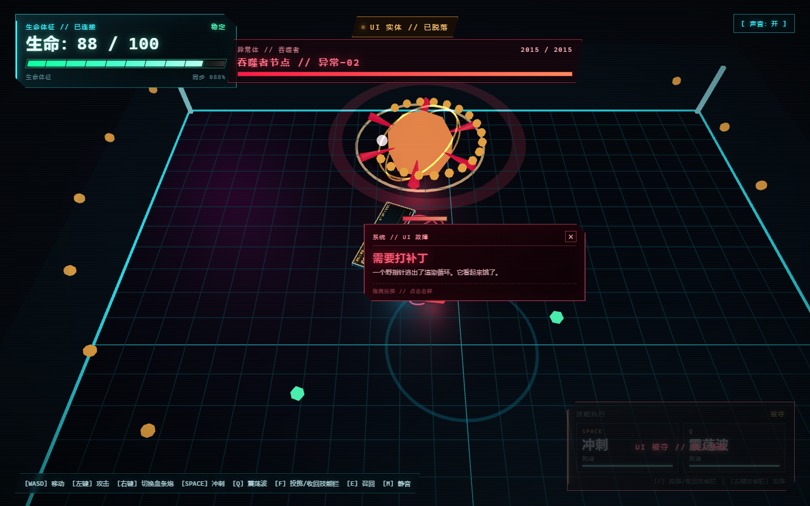
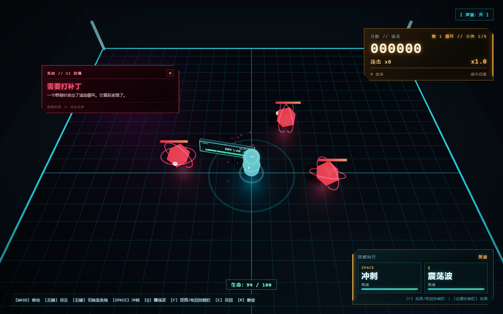

<div align="center">



# UI 吞噬者 / UI DEVOURER

**把血条从屏幕上扣下来，当作武器。**

一款用 **Vite + TypeScript + Three.js + Rapier3D** 制作的物理 HUD 弹幕射击游戏。

[](https://vite.dev/)
[](https://www.typescriptlang.org/)
[](https://threejs.org/)
[](https://rapier.rs/)
[](https://nodejs.org/)
[](#)

**你的 HUD 不是贴纸。** 生命条是弹药，技能栏是磁力诱饵，计分牌是炸弹；敌人会吞掉脱落的界面，首领会把你的 HUD 撕进战场。

</div>

---

## 🎮 核心玩法

```text
5 个小关  →  三选一强化  →  首领关  →  三选一强化  →  下一循环 …
```

- **无限循环**：每轮 5 个小关 + 1 个首领关，难度随循环持续上升；没有最终胜利，死亡才是终点。
- **HUD 物理化**：技能栏、计分牌、系统弹窗都能脱离屏幕，变成有重力、碰撞和惯性的 3D 物体。
- **弹幕 Boss**：首领用带缺口的环形弹、扇形齐射和螺旋弹幕制造走位压力；弹幕密，但单发伤害低，靠移动和冲刺穿缝。
- **35 张强化卡**：加特林、霰弹、双管、环切、回旋、追踪、连锁、血条炮……每局都能拼出不同的 Build。

## 🔫 血条炮

右键在 **制式枪 ↔ 血条炮** 之间切换。

| 属性 | 数值 |
| --- | --- |
| 单发伤害 | 100 |
| 消耗 | 4 生命 / 发，最低保留 1 点 |
| 穿透 | 3 个目标 |
| 射速 | 约 0.42 秒 / 发 |
| 特点 | 强击退；HUD 生命条隐藏，手持 3D 血条实时显示生命 |

血条炮模式下，屏幕底部会保留一个微型生命读数。风险来自隐藏 HUD、生命消耗和射击节奏。

## 🧩 四块 HUD，四种命运

| HUD | 锁定态 | 脱离 / 互动 |
| --- | --- | --- |
| **生命条** | 显示生命与护盾 | 右键切换为手持血条炮，不脱落 |
| **技能栏** | 冲刺 / 震荡波冷却 | 投掷成磁力诱饵，6 秒后 / 接触 / 被射击时爆炸；技能在脱落期间锁定 |
| **计分牌** | 分数 / 连击 / 击杀 | 受击会震动并脱落；射击或冲刺撞击触发分数爆发与高能弹幕 |
| **系统弹窗** | 随机遮挡视野 | 拖拽投掷或点击击碎，变成带范围伤害与眩晕的 3D 物理弹窗 |

敌人会优先吞噬脱落的技能栏和计分牌；首领会主动撕裂一个已锁定的 UI。按 `E` 可以召回尚未被夺走的 UI，并获得短暂护盾。

每个小关 / 首领关结束时会自动召回场上未失守的 UI，并回复 **15 / 30** 生命，避免带着脱落的 HUD 进入下一关。

## ☠️ 首领弹幕

首领每 5 个小关出现一次，分为 3 个血量阶段：

- **缺口环弹**：24 / 28 / 32 发环形弹，留出 5～6 发宽度的安全缺口。
- **扇形齐射**：9 / 11 / 13 发瞄准弹，向玩家方向展开。
- **螺旋弹幕**：2～3 条旋转臂，持续扫射。
- **阶段递进**：血量越低，攻击间隔越短、弹幕越密。

单发伤害 **1.5～3.5**，同屏弹幕有上限；重点是读弹、移动和用冲刺穿缝，而不是站桩对枪。

## 🕹️ 操作

| 输入 | 行为 |
| --- | --- |
| `W A S D` | 移动 |
| 鼠标移动 | 瞄准 / 控制朝向 |
| 鼠标左键 | 射击；血条炮模式下发射血条弹 |
| 鼠标右键 | 切换 **制式枪 ↔ 血条炮**；鼠标位于技能栏上时改为投掷技能栏 |
| `SPACE` | 冲刺（按移动方向；无移动时按朝向） |
| `Q` | 震荡波（范围伤害 + 眩晕） |
| `F` | 投掷 / 收回技能栏 |
| `E` | 召回所有未被敌人夺走的 UI，并获得短暂护盾 |
| `M` | 静音 / 恢复音效 |
| `1 / 2 / 3` | 强化界面选择卡片 |

## 🔫 射击方式

| 卡牌 | 机制 |
| --- | --- |
| 加特林协议 | 按住左键预热连射，射速随按住时间提升 |
| 霰弹写入 | 扇形多弹丸，近距离爆发 |
| 双管写入 | 每次射击变成两道并排弹道 |
| 环切协议 | 每第 6 次射击额外释放 10 发环形弹幕 |
| 回旋写入 | 子弹 0.45 秒后掉头，回程可再次命中 |
| 追踪写入 | 子弹缓慢追踪最近敌人 |
| 连锁电弧 | 命中后向附近最多 2 个敌人传导 35% 伤害 |
| 磁轨穿透 | 普通子弹获得额外穿透 |

所有玩家子弹使用独立碰撞组，霰弹 / 加特林 / 双管同时叠加也不会在枪口互相打掉。

## 🚀 快速开始

要求：**Node.js 20.19+**。

```bash
pnpm install
pnpm dev
```

打开终端里显示的地址（默认 <http://127.0.0.1:5173/>）。

也可以使用 npm：

```bash
npm install
npm run dev
```

### Windows 一键启动

双击桌面的「UI 吞噬者」快捷方式，或项目根目录的 `start-ui-devourer.cmd`：

1. 自动寻找 Node.js（PATH → `C:\Program Files\nodejs` → DSH 内置 Node）。
2. 启动 Vite 开发服务器并打开浏览器。
3. 关闭控制台窗口即可停止服务。

只启动服务、不打开浏览器：

```bat
start-ui-devourer.cmd --no-browser
```

### 生产构建

```bash
pnpm build
pnpm preview
```

## 📸 截图

<table>
  <tr>
    <td width="50%"></td>
    <td width="50%"></td>
  </tr>
  <tr>
    <td align="center">血条炮：HUD 隐藏，手持血条与底部生命读数</td>
    <td align="center">Boss 弹幕：缺口环弹 / 扇形齐射 / 螺旋</td>
  </tr>
</table>

## 🏗️ 工程结构

```text
ui-devourer/
├─ index.html                 # 画布、HUD、弹窗、强化 / 结算界面
├─ src/
│  ├─ main.ts                 # 主循环、输入、波次 / 敌人 / 特效接线
│  ├─ style.css               # 赛博 HUD、弹窗、故障艺术、响应式
│  ├─ core/
│  │  └─ PhysicsWorld.ts      # RAPIER.init、固定步进、刚体 / 碰撞体工厂
│  ├─ entities/
│  │  ├─ Player.ts            # 角色控制、制式枪 / 血条炮、全部弹道
│  │  ├─ Enemy.ts             # 猎手、节点 / 首领、弹幕模式、UI 吞噬
│  │  ├─ UIPanel.ts           # 物理 HUD 面板 + 双面 CanvasTexture
│  │  └─ UIEntityManager.ts   # HUD 状态机、手持血条炮、弹窗、计分牌
│  ├─ systems/
│  │  ├─ WaveSystem.ts        # 无限 5+1 循环、35 张强化卡、难度缩放
│  │  ├─ EffectsSystem.ts     # 粒子、冲击波、顿帧、震屏
│  │  └─ SoundSystem.ts       # Web Audio 程序化音效
│  └─ ui/
│     └─ HudOverlay.ts        # DOM HUD、弹窗、强化 / 结算、故障叠层
├─ docs/                      # README 截图
├─ start-ui-devourer.cmd      # Windows 一键启动
└─ vite.config.ts
```

## 🛠️ 技术要点

- **固定时间步物理**：以 1/60s 推进 Rapier，玩家、敌人、子弹、UI 和波次逻辑都在固定步内执行。
- **双面 CanvasTexture**：物理面板正反面各用独立 canvas / texture，避免 three r187 下共享 source 导致背面纹理不更新。
- **子弹碰撞组**：所有玩家子弹共享组并过滤同组，解决霰弹 / 加特林在枪口自碰撞的问题。
- **传感器穿透弹**：磁轨 / 血条炮使用 sensor collider，通过碰撞事件逐目标结算并递减穿透次数。
- **HUD 状态机**：`docked / loose / carried / held` 四种状态统一驱动 DOM、3D 面板、敌人携带和召回。
- **程序化音频**：没有音频文件，所有射击、破碎、UI 脱落、Boss 警报都由 Web Audio 实时合成。
- **顿帧与震屏**：命中、击杀、UI 爆裂都有 hitstop、trauma shake、粒子和故障艺术叠层。

## 🧪 调试

开发模式（`import.meta.env.DEV`）下，浏览器控制台可访问：

```js
window.__UI_DEVOURER__
// { player, ui, wave, enemies, effects, sound, overlay, camera, getBoss }
```

常用：

```js
__UI_DEVOURER__.ui.getHp();
__UI_DEVOURER__.ui.isHpHeld();
__UI_DEVOURER__.ui.toggleHpWeapon();
__UI_DEVOURER__.wave.getStats();
__UI_DEVOURER__.wave.getModifiers();
__UI_DEVOURER__.enemies.length;
```

生产构建不会注入该句柄。

## 🗺️ Roadmap

- [x] 无限 5 小关 + 首领循环
- [x] 血条炮 / 物理 HUD / 敌人吞噬
- [x] 35 张强化卡与 8 种射击方式
- [x] 三阶段弹幕 Boss
- [ ] 更多首领弹幕谱面与阶段演出
- [ ] 精英词缀、商店与局外成长
- [ ] 手柄 / 移动端适配

## 📄 说明

- 玩家可见文本以中文为主，保留 `UI`、`SPACE`、`Q` 等技术 / 按键标识。
- 游戏没有最终胜利：无限循环，死亡结算，再来一局。
- 如果这个项目让你觉得有点意思，欢迎点一个 ⭐。

<div align="center">

**UI 吞噬者 — 吞噬界面，夺取混沌。**

</div>
